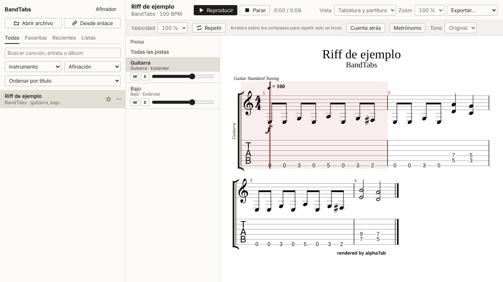

# BandTabs

Visor y reproductor de tablaturas para Windows, de código abierto. Abre archivos Guitar Pro,
MusicXML, MIDI y tabs en texto, los dibuja como tablatura o partitura y los reproduce con un
cursor que sigue la música. También saca un borrador de tablatura a partir de un vídeo de YouTube,
una canción de Spotify o un archivo de audio.

Todo se guarda y se procesa en tu equipo. No hay cuenta ni servidor.



## Instalación

Descarga `BandTabs_X.Y.Z_x64-setup.exe` de la [última versión](https://github.com/FormosoCrl/BandTabs/releases/latest)
y ábrelo. Se instala para tu usuario, sin permisos de administrador, y no necesita nada más.

El instalador no está firmado, así que Windows SmartScreen puede avisar la primera vez. En ese
caso pulsa "Más información" y después "Ejecutar de todas formas".

## Uso

Formatos que abre: `.gp`, `.gp3`, `.gp4`, `.gp5`, `.gpx`, `.xml`, `.musicxml`, `.mxl`, `.mid`,
`.txt`, `.tab` y `.atex`. Puedes usar el botón "Abrir archivo" o soltar los archivos sobre la
ventana. En los MIDI y las tabs de texto la app elige cuerda y traste, y en las tabs de texto
estima también el ritmo, porque no lo indican.

En el reproductor puedes:

- cambiar entre tablatura, partitura, las dos, o acordes con la letra;
- bajar o subir la velocidad (25 a 150 %) sin cambiar el tono;
- repetir unos compases: arrástralos con el ratón y pulsa Repetir (o la tecla L);
- activar cuenta atrás y metrónomo, y transponer el sonido hasta 12 semitonos;
- silenciar pistas, dejar una sola o ajustar su volumen;
- exportar a Guitar Pro, MIDI o WAV, e imprimir.

La barra espaciadora reproduce y pausa. El afinador usa el micrófono y sirve para guitarra, bajo
y ukelele. La biblioteca tiene búsqueda, filtros por instrumento y afinación, favoritas,
recientes y listas.

### Desde un enlace

"Desde enlace" acepta un enlace de YouTube, uno de Spotify o un archivo de audio. La app separa
los instrumentos y escribe guitarra y bajo en tablatura, piano y voz en partitura, la batería,
los acordes y la letra.

La primera vez descarga el analizador y sus modelos, unos 2 GB, en
`%LOCALAPPDATA%\io.github.formosocrl.bandtabs\engine`. Después funciona sin conexión salvo para
bajar el audio. Una canción de cuatro minutos tarda entre 5 y 10 minutos en un portátil normal.

Es un borrador. Suele acertar con el bajo, la batería y los acordes, y falla más con guitarras
muy distorsionadas o solos rápidos.

De Spotify solo se leen el título y el artista de la página pública; el audio se busca en
YouTube. Usa solo canciones que tengas derecho a usar: descargar de YouTube puede ir contra sus
condiciones, y eso es responsabilidad de quien lo hace.

Por dentro usa [Demucs](https://github.com/facebookresearch/demucs) para separar instrumentos,
[Basic Pitch](https://github.com/spotify/basic-pitch) para las notas,
[librosa](https://librosa.org) para tempo, compases, acordes y batería,
[faster-whisper](https://github.com/SYSTRAN/faster-whisper) para la letra y
[yt-dlp](https://github.com/yt-dlp/yt-dlp) para bajar el audio.

## Desarrollo

En Windows, `iniciar.cmd` instala Node.js, Rust y las herramientas de C++ con `winget` la primera
vez, descarga las dependencias y abre la app.

| Comando | |
|---|---|
| `npm run app` | App de escritorio en modo desarrollo |
| `npm run app:build` | Instalador, en `src-tauri\target\release\bundle\nsis\` |
| `npm run dev` | Solo la interfaz, en el navegador (<http://localhost:1420>) |
| `npm test` | Tests |
| `npm run lint` | ESLint |
| `npm run typecheck` | Tipos |

Las versiones se publican desde GitHub: Actions, Release, Run workflow, con el número de versión.
Tarda unos 15 minutos y deja el instalador en Releases.

```
src/
  App.tsx                     Ventana principal e importación
  components/Player.tsx       Visor y reproductor (alphaTab)
  components/LibraryPanel.tsx Biblioteca
  components/TranscribeDialog.tsx  Ventana "Desde enlace"
  lib/importers/              MIDI, tabs en texto y resultado del analizador a alphaTex
  lib/library.ts              Biblioteca sobre IndexedDB (Dexie)
src-tauri/                    App de escritorio (Tauri 2, Rust)
src-tauri/engine/             Analizador en Python y su instalador
tests/                        Tests
docs/ROADMAP.md               Plan por fases
```

## Créditos

[alphaTab](https://alphatab.net) (MPL-2.0) dibuja y reproduce las partituras, con la fuente
Bravura (SIL OFL) y el soundfont Sonivox. La app usa [Tauri](https://tauri.app),
[React](https://react.dev) y [Dexie](https://dexie.org).

## Licencia

[GPL-3.0 o posterior](LICENSE).
